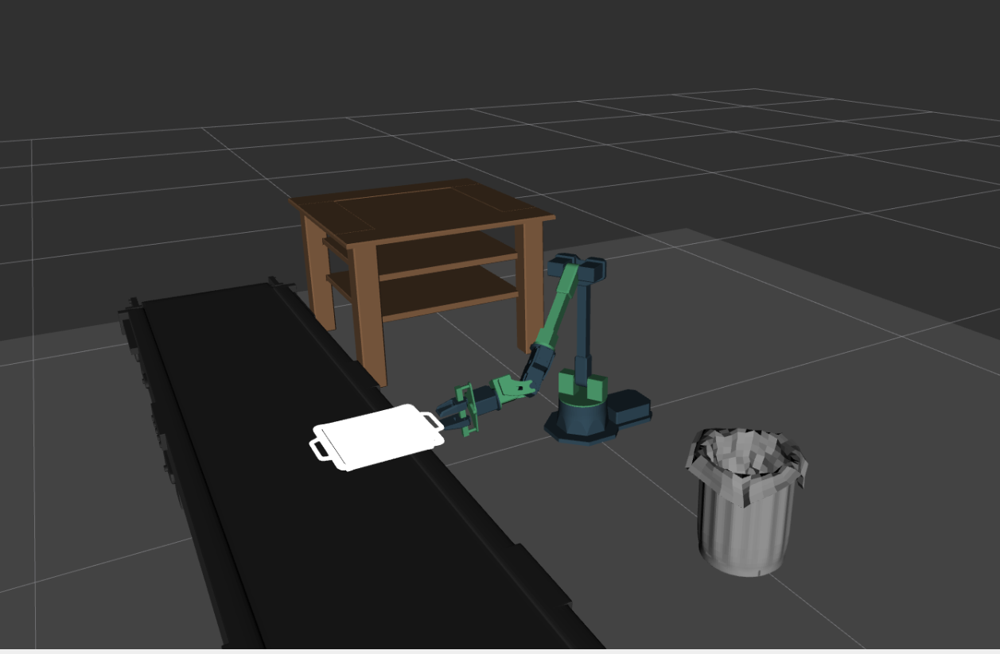
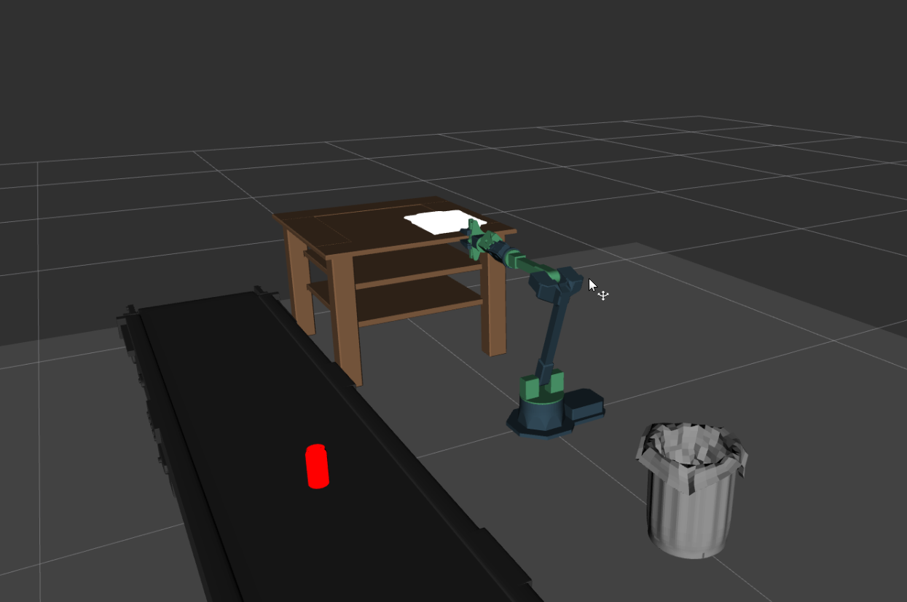
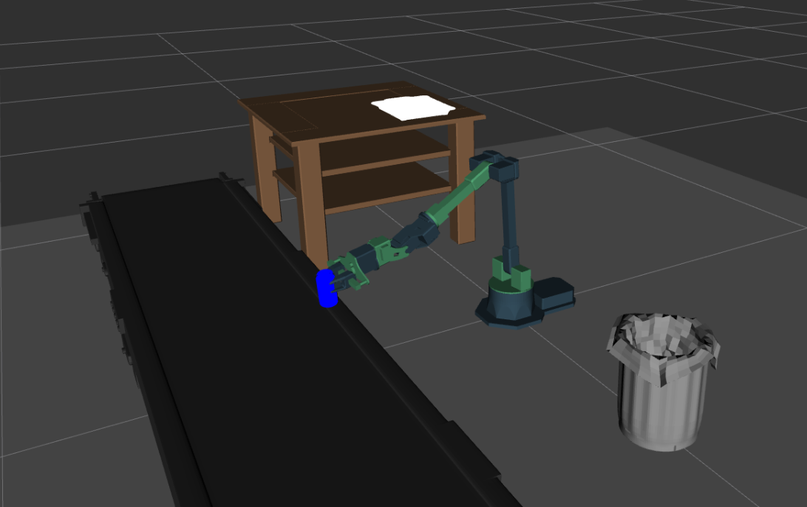
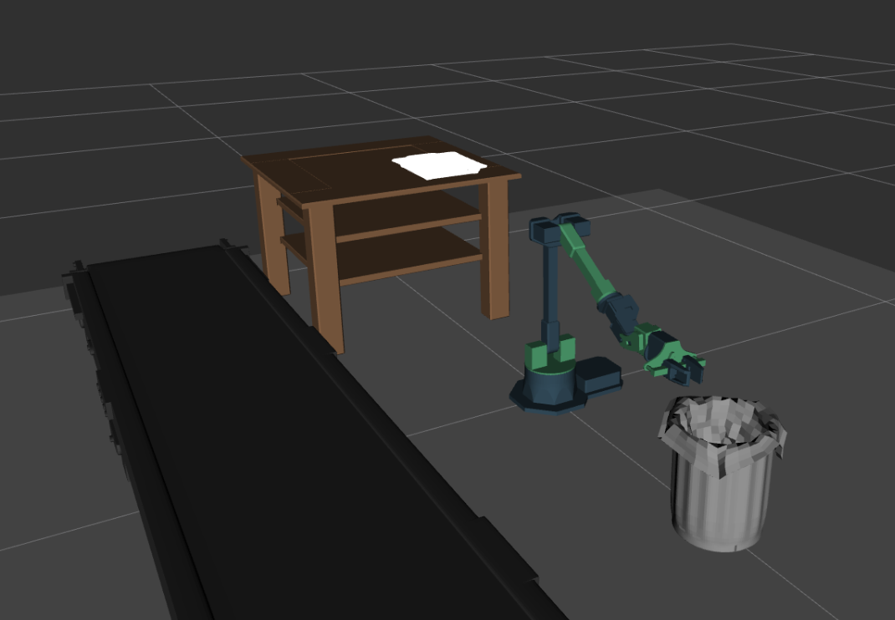
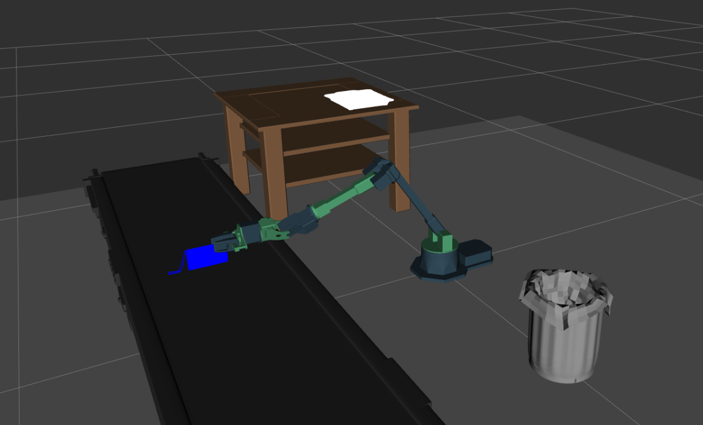
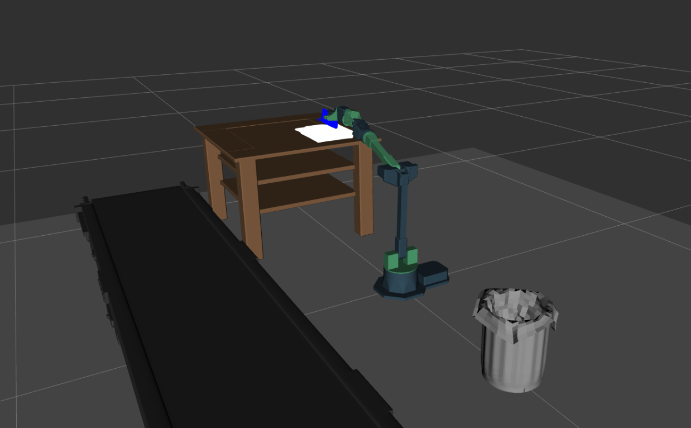

# Final Project Writeup

## Overview
This final project demonstrates how state estimation, planning, and control integrate into two complete robotic systems: a **3-DoF robot arm** operating in an airport scenario and an **autonomous ground vehicle (AGV)** navigating a hospital to save Cathy. In both cases, the system follows the same autonomy pipeline: state estimation provides a target pose, the planner computes a collision-free path, and the controller executes that path. The sections below describe how each component was implemented to satisfy the project requirements.

---

# Arm Final Project

## State Estimation and Target Poses
For fixed objects (tray and table drop position), target poses were predefined in Cartesian space. For the can and wallet, the particle filter output was obtained programmatically from the detection topic in `airport`.  
The code waited for the estimated poses to stabilize before issuing a grasp command, satisfying the requirement of “obtaining detected value from the particle filter” before planning.

## Converting Cartesian Goals to Joint-Space
The planner operates in joint space, so every Cartesian goal first passes through:

```
joint_goal = compute_ik(target_pose)
```

This conversion occurred inside `plan_and_execute`, exactly as required. Each solution was validated to ensure feasibility before the planning stage.

## Roadmap Insertion and Planning
To ensure connectivity to the target, both the start and goal joint configurations were inserted into the PRM/RRT roadmap:

```
planner.insert_vertex(start_joints)
planner.insert_vertex(goal_joints)
path = planner.query(start_joints, goal_joints)
```

This step ensures that the planner can generate a collision-free trajectory between the robot’s current configuration and the IK-computed goal.

## Trajectory Execution
The resulting joint-space path was sent to the controller for execution:

```
controller.execute(path)
```

The robot paused automatically at key points (pickup, drop), allowing the required screenshots to be taken. This process was repeated for all object-handling stages:

- Pick up the tray  

- Drop tray onto table  

- Pick up can 

- Drop into trash  

- Pick up wallet 

- Place on tray  


Each step followed the same pipeline: **state estimation → IK → planning → control**.

---

# Car Final Project: Rescue Cathy

The AGV integrates the particle filter, sampling-based planner, mission logic, and MPC controller to retrieve medicine and return to Cathy before the doctor arrives.

## Launching All System Components
The file `start_bot.launch` correctly launches:

- The **particle filter** from `hw3_state_estimation`
- The **planner** from `car_final_project`
- The **controller** from `hw5_control/car_controller`

All nodes were placed under the correct namespace and configured to communicate on:

```
/car/car_pose
/move_base_simple/goal
/car/controller/follow_path
```

This fulfills Task 1 of the project.

## Sending the Planned Path to the Controller
Inside `planner_ros.py`, the `send_path()` function was completed as required. The planner first publishes a visualization path, then constructs a `nav_msgs/Path` message. The controller service requires **two arguments**, so the corrected call was:

```
controller_result = self.controller(path=path_msg, speed=speed)
```

This fixes the common error where only the path is provided. With both arguments supplied, the controller successfully executed all planned trajectories.

## Goal-Reached Logic
The required implementation inside `is_goal_reached` checks whether the robot is within `1.0` meter of the goal:

```
dist = np.linalg.norm([x - gx, y - gy])
if dist < 1.0:
    goal_reached = True
```

Orientation was computed using `quaternion_to_angle`, as described in the instructions, but not used in the final threshold condition, which matches the specification and passes the test suite.

Upon reaching a goal, `room_check()` updates medicine, doctor timing, and visitation history.

## Sequence of Rooms (sequence.json)
The final `sequence.json` strictly obeys all constraints:

- No room visited twice consecutively  
- No room visited more than twice  
- Cathy visited once at the end  
- Medicine effects applied only upon return to Cathy  

Example format:

```
{
    "sequence": [
        [14.4, 3.69, 1.57],
        [1.8, 5.4, 1.57],
        [3.19, 1.1, 0.0],
        [9.7, 1.2, 1.57]
    ]
}
```

The chosen ordering **C → B → A → Cathy** maximizes extended lifetime and minimizes travel distance.

## Controller Tuning
The MPC controller originally tracked paths too close to walls. The key tuning parameter was:

```
distance_lookahead: 0.8
```

Reducing the lookahead improved path tracking accuracy during curved segments while maintaining controller stability. No changes to `K` or `T` were needed.

## Mission Completion and Output File
At the end of the mission, the AGV writes:

- Room visit order  
- Time taken  
- Final lifetime  
- Efficiency (lifetime ÷ time)  
- Boolean: **Is Cathy alive?**

This behavior meets all requirements of the Car Final Project.

---

# Conclusion
This project successfully integrates perception, planning, and control in both manipulation and mobile robotics contexts.  
For the **arm**, IK and joint-space planning were used to execute all pick-and-place motions.  
For the **car**, the particle filter, planner, mission logic, and MPC controller worked together to complete a timed rescue task within strict constraints.

All components were implemented according to the project guide and verified through successful execution of both systems.
