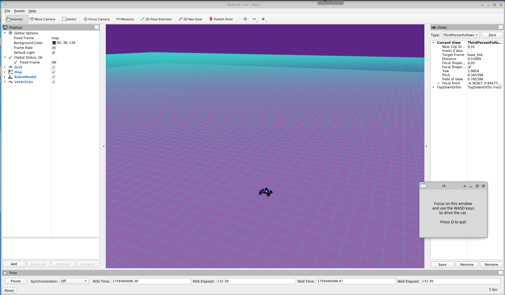
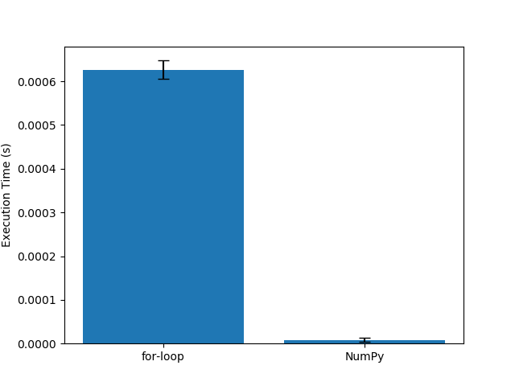
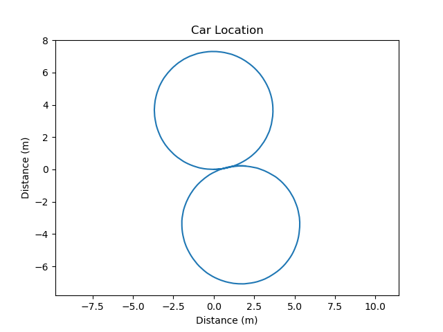
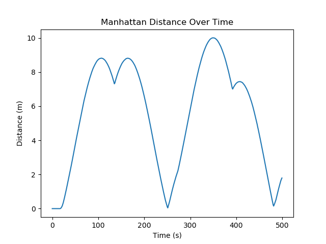
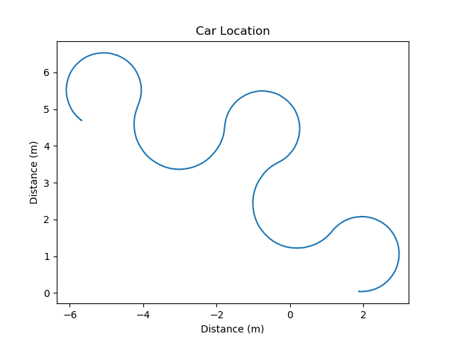
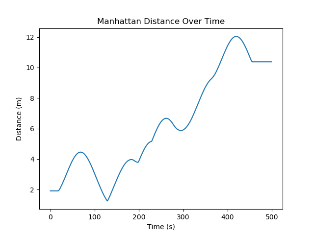

# Homework 1: 
Define in your own words what a node, topic, publisher, and subscriber are and how they relate to each other.</li>
<ol>
<li>Node: A process that performs computation in ROS. Nodes are the fundamental building blocks of a ROS system.</li>
<li>Topic: A named communication channel that nodes use to exchange messages.</li>
<li>Publisher: A node that sends out messages on a topic.</li>
<li>Subscriber: A node that receives messages from a topic.</li>
<li>Relationship: Publishers and subscribers don’t connect directly — they communicate through topics, and the ROS master handles message passing between them.</li>
</ol>

What is the purpose of a launch file? </li> 
<li>Explain that a launch file automates starting multiple ROS nodes and setting parameters. It allows you to configure topics, remap names, and start an entire system with a single command instead of manually launching each node.</li>

Include your RViz screenshot showing the car. 

Include your runtime_comparison.png figure for the different norm implementations. 

Include the locations.png and norms.png figures for the plan figure_8.txt. Make sure the plots contain labelled axes and a title.  

Include the locations.png and norms.png figures for the plan crown.txt. Make sure the plots contain labelled axes and a title.

