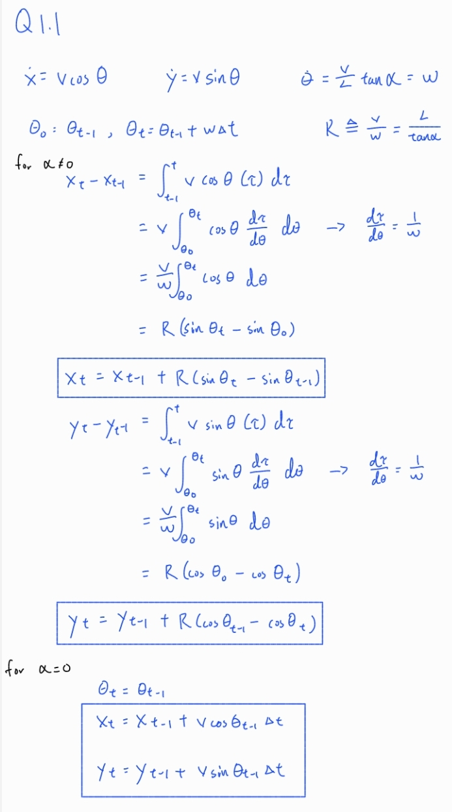
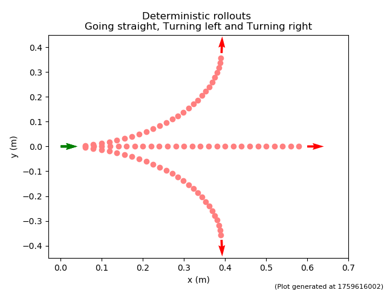
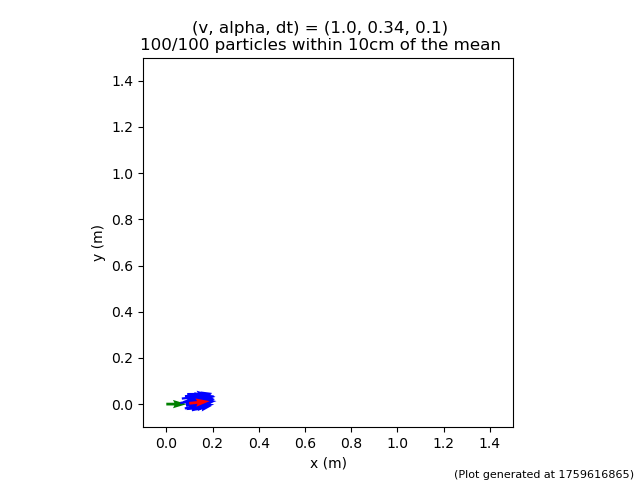
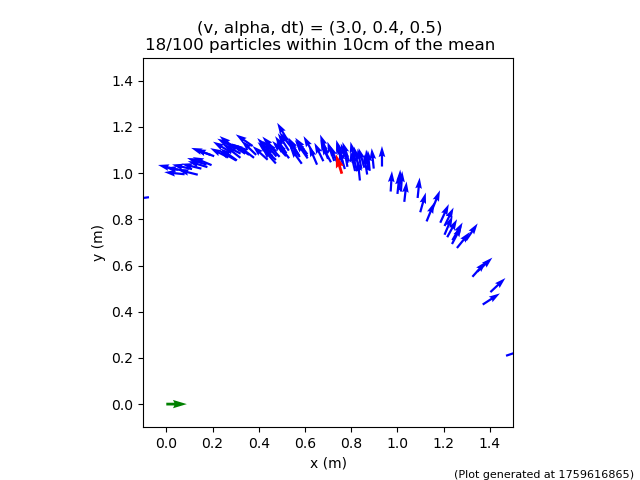

# Homework 2: 
Q1.1 derivation for xt and yt:

Q1.3 matching output in Figure 2:

Q1.5 
With parameter vel_std: 0.05; alpha_std: 0.10; x_std: 0.012; y_std: 0.012; theta_std: 0.05, I successfully generated similar output plot in Figure 3 and 4.
Question: Why does the motion model produce more particles within 10 cm of the deterministic model prediction in Figure 3 than in Figure 4?
Figure 3 corresponds to a small steering angle (α ≈ 0.34 rad) and shorter duration (Δt = 0.1 s). Because the car travels almost straight and for a short time, small perturbations in control inputs (v,α) cause only minor deviations. Both action noise and model noise have limited time to accumulate, so nearly all particles remain close to the deterministic trajectory — producing a tight cluster where almost 100 % of the samples lie within 10 cm of the mean.

Figure 4, on the other hand, uses a larger steering angle (α = 0.4 rad) and longer duration (Δt = 0.5 s). Here, small differences in α translate to noticeably different turning radii, so each particle follows a slightly different arc. Over time, these curvature differences amplify, spreading particles along a banana-shaped curve. As a result, fewer particles remain close to the deterministic prediction — only ~18 % fall within 10 cm of the mean.

