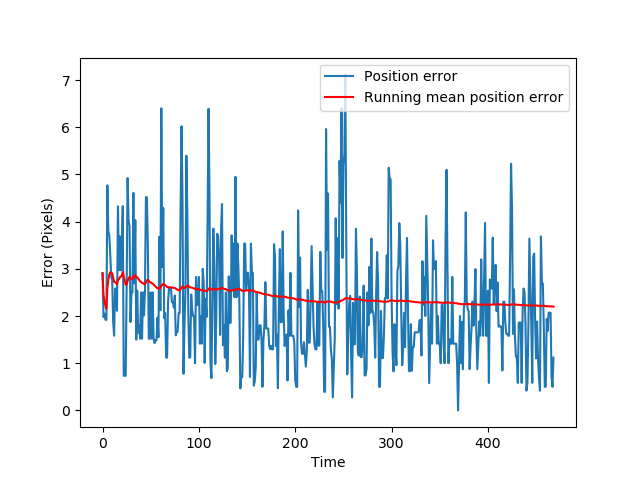
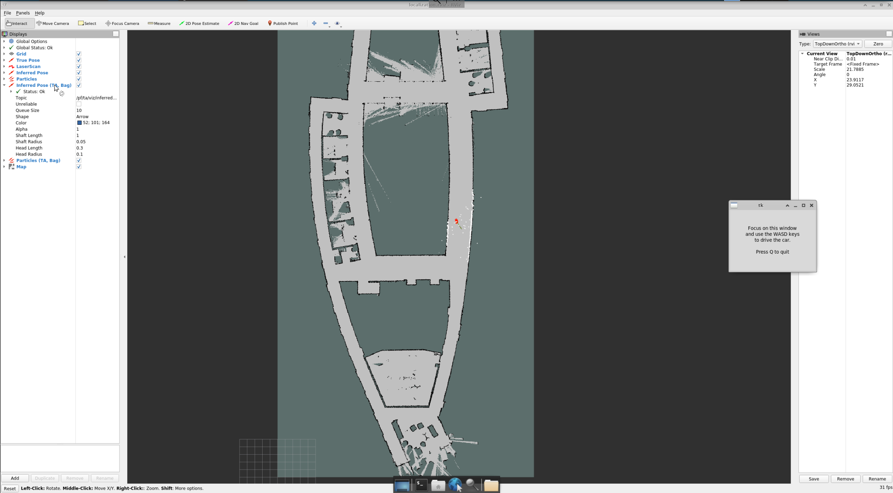
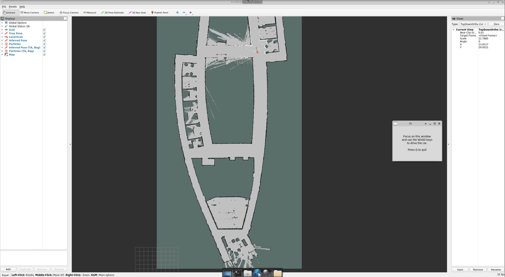

# Homework 3: State Estimation 

### Q1.4 – Parameter Tuning

To tune the particle filter for stable and accurate tracking, I adjusted the number of particles, process noise (`std_constant_vel`), and initial covariance.  
I began with a wide prior and large noise, which caused particles to spread excessively across the frame. By gradually reducing both, I achieved a tighter distribution centered near the detected cylinder.

**Final tuned parameters**
- `num_particles = 600`
- `std_constant_vel = 3.0`
- `initial_cov = diag([35², 35²])`
- `constant_vel = [0, 0]`

These values produced smooth motion and accurate convergence without excessive jitter.  
A smaller noise caused lag, while a larger one increased randomness.  
The final configuration achieved a **mean position error of about 2 pixels**, as shown by the red running mean in the plot, indicating consistent and stable tracking performance.

#### **Plot of position error across time**

### Q2.2 – Publisher Verification

The resulting visualization confirmed that the publishers worked correctly and that the pose and particle topics were being updated in real time.

### Q2.3 – Particle Cloud Shape Analysis

For this task, the car was driven to two distinct locations shown by the red arrows in the provided map.  
Screenshots of the particle cloud at both locations are saved in `../figures/rviz_tracking1.png` and `../figures/rviz_tracking2.png`.

#### **Location 1 – Hallway (Straight Orientation)**

At this position, the car is placed in a long hallway and pointed straight down the corridor.  
The particle cloud forms a **narrow, elongated distribution along the hallway axis**.  
This occurs because the laser scan provides strong constraints on the car’s **lateral position**—walls on both sides tightly restrict side movement—but weak constraints on **longitudinal position**.  
As a result, the filter maintains higher uncertainty along the direction of travel (forward–backward) while being confident across the hallway width.

#### **Location 2 – Intersection (Open Area)**

Here, the car is positioned in the center of an intersection where multiple corridors intersect.  
The particle cloud becomes **wider and more diffuse**, spreading across several possible corridors and headings.  
This shape reflects higher uncertainty because the laser scan matches multiple map regions symmetrically—the sensor readings look similar in several directions.  
The filter thus distributes belief across more possible poses until the car moves or more distinctive features are observed.

#### **Summary**
- **Hallway:** narrow, elongated cloud → constrained laterally, uncertain longitudinally.  
- **Intersection:** wide, multi-directional cloud → ambiguous environment geometry increases uncertainty.

These results confirm that the particle filter correctly encodes spatial ambiguity: the particle cloud expands in open or symmetric areas and contracts in constrained environments.
