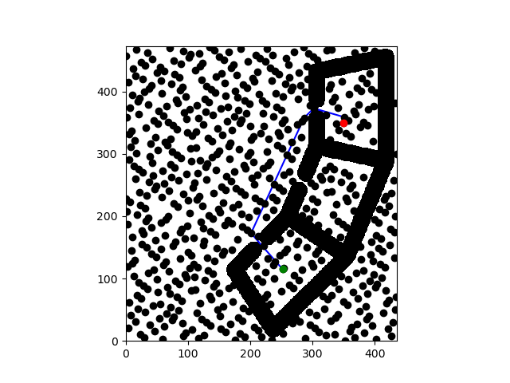
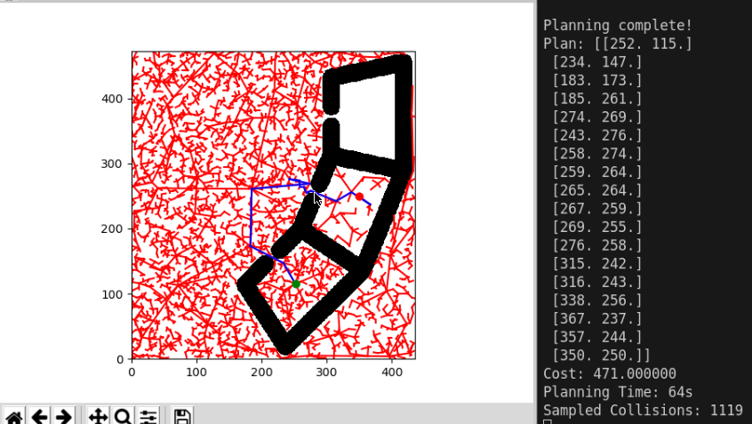
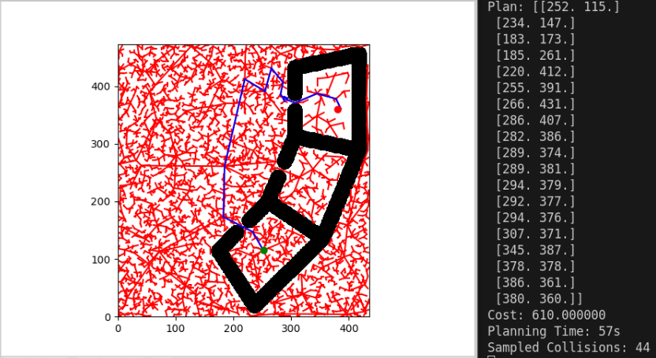
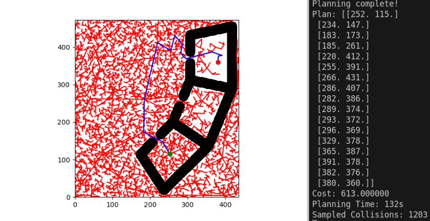
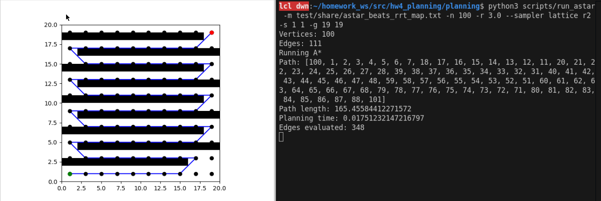
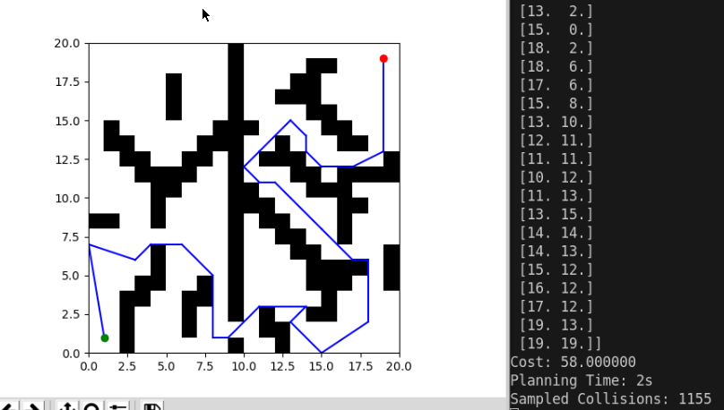

# Project 4: Planning

**Q1.2** 

A* Shortest Path Figure: 

**Q2.1** 

RRT Path Figure: 

**Q2.2** 

RRT Path Figure With Path Reuse: 

RRT Path Figure Without Path Reuse: 

Reusing the RRT tree greatly improved planning efficiency. With reuse, the planner completed in 57 s with only 44 collisions, compared to 132 s and 1203 collisions without reuse, while producing a nearly identical path cost (~610). The improvement occurs because the reused tree already contains valid samples and edges near the new goal, reducing exploration and collision checks. Tree reuse is most effective when the new goal is close to the previous one in the same free space, but offers little benefit if the goal or environment changes significantly.

**Q3**

A* beats RRT Figure: 

RRT beats A* Figure: 

In this updated RRT-beats-A* map, the environment is cluttered and irregular, with scattered obstacles that make it difficult for a grid-based or lattice-based planner like A* to find a connected path. A* relies on pre-defined nodes and fixed connectivity, so if the sampled lattice does not align with narrow gaps or irregular free spaces, it fails to reach the goal. In contrast, RRT performs better because it samples the space continuously and can adaptively explore through non-uniform gaps, avoiding the need for complete graph connectivity. This highlights the tradeoff: A* excels in structured, fully connected environments where paths are predictable, while RRT is more effective in complex, unstructured, or partially disconnected spaces where random exploration can discover feasible routes that deterministic graph search cannot.

**Q5**

For the WidowX250 arm, I designed the heuristic by directly leveraging the structure of the joint-space distance metric already used in the planner. Since the true edge cost between two configurations is defined as the sum of the minimal angular differences across all six joints (accounting for 2π wrap-around), an admissible heuristic must never exceed this value. Therefore, the heuristic simply computes that same per-joint wrapped angular difference and sums it, producing the minimum possible motion required to reach the goal. This guarantees admissibility because any feasible collision-free path must rotate each joint by at least this amount, while obstacles or kinematic constraints can only increase the required cost. To avoid floating-point overshoot, a small epsilon is subtracted to keep the heuristic strictly below or equal to the true cost.