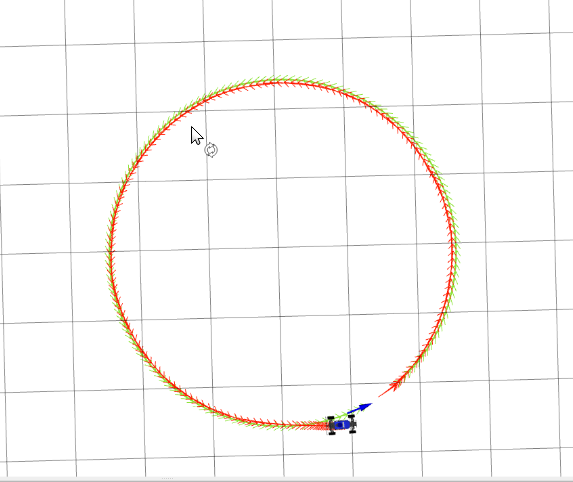
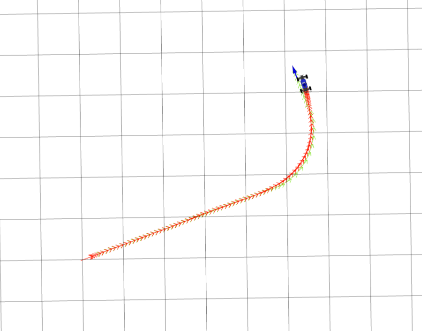
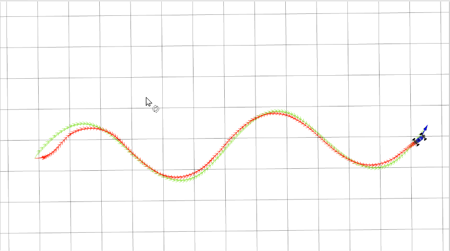
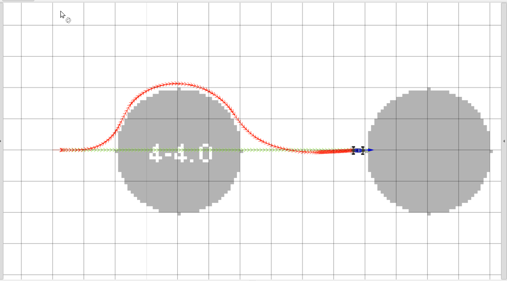

# Project 3: Control 

## Q1. Reference State Selection and Error Computation

I implemented `get_reference_index` to select a waypoint approximately `distance_lookahead` ahead of the car. The algorithm finds the closest waypoint and searches forward for the first point whose distance from the vehicle exceeds the lookahead distance; if none exists, it selects the final waypoint. This ensures forward progress and prevents selecting points behind the car.

`compute_position_in_frame` transforms the vehicle’s global pose into the reference waypoint’s coordinate frame by translating and applying the inverse rotation. The result provides along-track and cross-track errors used throughout the controller. Both Q1 functions passed all tests in `test/controller.py`.

## Q2. PID Pure-Pursuit Controller

I implemented the PID control law using cross-track error and heading error while ignoring along-track error. The cross-track derivative is computed analytically as
`de_ct/dt = v * sin(theta - theta_ref)`
and the integral term is accumulated numerically. The controller returns the reference velocity and the PID-computed steering angle.

### PID Tuning

I tuned the controller on the `circle`, `left-turn`, and `wave` paths. I increased `kp` until tracking was responsive but began to oscillate, then increased `kd` to stabilize turns. A very small `ki` was added to correct small steady-state bias on circular motion.

Final PID gains:

`kp = 0.6  ki = 0.0001  kd = 0.4`

PID Results

These parameters yield smooth tracking with minimal overshoot and no oscillation.

## Q3. WidowX250 Arm PID Controller

I implemented a joint-space PID controller where joint error is the difference between current position and reference. The derivative is computed as the error difference times frequency, and the integral is accumulated over time. The output is a 6-D joint velocity command. The implementation passed all tests in `arm_controller/test/pid.py` and produced smooth waypoint tracking.

## Q4. Model Predictive Control (MPC)

I implemented all four MPC components:

**1. Control Sampling:**
Generated `K` steering-angle sequences evenly spaced in `[min_alpha, max_alpha]`, each repeated for `T-1` timesteps.

**2. Rollout Generation:**
Applied the kinematic car model to propagate each sequence and produce a `K × T` set of predicted states.

**3. Cost Computation:**
The cost is the weighted sum of final-state distance error and the number of colliding states in each rollout.

**4. Control Selection:**
Chose the lowest-cost rollout and returned its first action.

All MPC unit tests passed.

### MPC Tuning
I tuned MPC using the `slalom_world` map. Increasing `K` improved angular resolution, while increasing `T` allowed better forward prediction. A larger `distance_lookahead` significantly improved trajectory smoothness by biasing the controller toward forward progression instead of aggressively following the immediate waypoint.

Final MPC parameters:

`K = 62  T = 8  distance_lookahead = 1.5`

These values produced smooth obstacle-avoidance behavior and tight convergence back to the reference path.

### MPC Results

Insert your screenshot(s):

### Saw Path Difficulty

The saw-tooth path contains abrupt curvature discontinuities that exceed the kinematic turning limits of the car. Because MPC only optimizes over a finite horizon, many rollouts cannot match these sudden changes, making distance costs large and the optimization landscape highly non-convex. This makes the saw path inherently hard to track accurately.

## Conclusion

In this assignment I implemented and tuned PID and MPC controllers for both car and robotic arm platforms. PID performed well on smooth reference paths, while MPC enabled robust tracking in obstacle-rich environments. Through iterative tuning of gains and horizon parameters, the final controllers achieved stable, accurate, and repeatable tracking behavior.